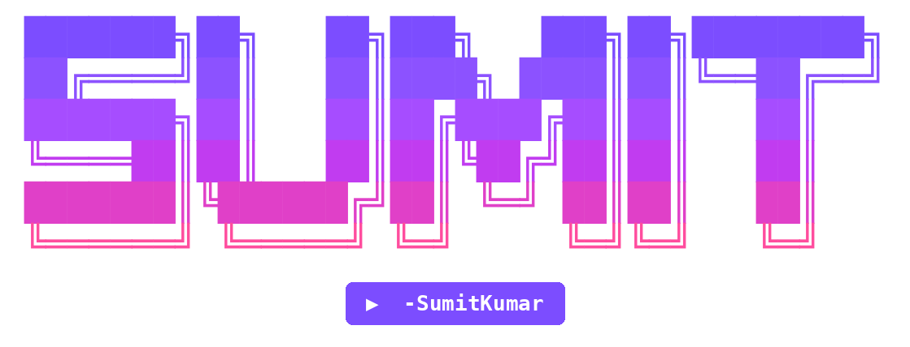

<p align="center">
  
</p>

<p align="center">
  <b>Interactive terminal tools for GitHub Codespaces</b><br>
  Download YouTube videos and share files anonymously, all with arrow keys.
</p>

<p align="center">
  
  
  
  
</p>

---

<h2 align="center">What's inside</h2>

<div align="center">

| Command | File | What it does |
|:-------:|:----:|:-------------|
| `yt` | `dl.py` | Search or paste a link, pick a quality, download as **MP4** |
| `share` | `share.py` | Pick a file with arrow keys, upload to **Gofile**, get a link |

</div>

---

<p align="center">
  
</p>

<h2 align="center">🎬 YouTube Downloader (<code>yt</code>)</h2>

### Features

- Paste a YouTube link **or** type a keyword to search (top 10 results)
- Arrow-key menus: pick the video, then pick the quality (144p up to 4K)
- Always saves as **MP4** (prefers H.264/AAC so it plays everywhere)
- Live progress bar with speed and ETA
- Red banner, colours, and a "Download another?" loop
- Uses `cookies.txt` automatically if present (fixes the "confirm you're not a bot" error)

### How to use

```bash
yt
```

1. Paste a link or type a search, press **Enter**
2. Use **↑ / ↓** to pick a video (if you searched)
3. Use **↑ / ↓** to pick a quality, press **Enter**
4. Wait for the download to finish

---

<p align="center">
  
</p>

<h2 align="center">📤 Gofile Uploader (<code>share</code>)</h2>

### Features

- Arrow-key file browser: the hovered item is Gofile blue, the rest are grey
- **Enter** on a folder opens it, **Enter** on a file uploads it right away
- `.. (go up)` to move back a folder
- Live upload progress with size, speed, and ETA
- Centered share-link box when finished
- Anonymous: no account or login needed
- Warns you before uploading `cookies.txt`

### How to use

```bash
share
```

1. Navigate with **↑ / ↓**
2. Press **Enter** on a file to start uploading
3. Copy the link from the **Share this link** box

> Uploads one file per run. To share a folder, zip it first:
> `zip -r myfolder.zip myfolder`

---

<h2 align="center">⚙️ Setup</h2>

### 1. Install ffmpeg and yt-dlp

```bash
sudo apt update && sudo apt install -y ffmpeg
python3 -m pip install -U "yt-dlp[default]"
```

### 2. Install the Python libraries

```bash
python3 -m pip install rich questionary requests requests-toolbelt
```

If pip shows an `externally-managed-environment` error, add `--break-system-packages`.

### 3. Create the `yt` and `share` commands

```bash
mkdir -p ~/.local/bin

cat > ~/.local/bin/yt << 'EOT'
#!/bin/bash
python3 /workspaces/Youtube-Downloader/dl.py "$@"
EOT

cat > ~/.local/bin/share << 'EOT'
#!/bin/bash
python3 /workspaces/Youtube-Downloader/share.py "$@"
EOT

chmod +x ~/.local/bin/yt ~/.local/bin/share
```

Now `yt` and `share` work from any folder. Videos are saved in the folder you run `yt` from.

> If the commands vanish after a Codespace **rebuild**, just run step 3 again.

---

<h2 align="center">🍪 Fixing "Sign in to confirm you're not a bot"</h2>

YouTube often blocks cloud IPs like Codespaces. The fix is a `cookies.txt` file:

1. On your computer, open an **incognito** window and log in to YouTube
2. In that same tab, open `https://www.youtube.com/robots.txt`
3. Export the cookies with a browser extension such as **Get cookies.txt LOCALLY**
4. Close the incognito window
5. Drag `cookies.txt` into this project folder in Codespaces

`dl.py` picks it up automatically.

**Keep it safe:** `cookies.txt` holds your logged-in session. Never commit or share it.

```bash
echo "cookies.txt" >> .gitignore
```

Delete it when you're done: `rm cookies.txt`

---

<h2 align="center">📁 Project structure</h2>

```
Youtube-Downloader/
├── assets/
│   ├── sumit.png      # README banners
│   ├── youtube.png
│   └── gofile.png
├── dl.py              # YouTube downloader  (command: yt)
├── share.py           # Gofile uploader     (command: share)
├── cookies.txt        # optional, keep private
├── .gitignore
└── README.md
```

---

<h2 align="center">🧰 Built with</h2>

<p align="center">
  <a href="https://github.com/yt-dlp/yt-dlp">yt-dlp</a> •
  <a href="https://ffmpeg.org">ffmpeg</a> •
  <a href="https://github.com/Textualize/rich">rich</a> •
  <a href="https://github.com/tmbo/questionary">questionary</a> •
  <a href="https://gofile.io">Gofile</a>
</p>

---

<h2 align="center">⚠️ Notes</h2>

- Downloading YouTube videos may violate YouTube's Terms of Service. Only download content you have the right to use.
- Anyone with a Gofile link can download the file, and Gofile may delete old or inactive anonymous uploads. Don't use it as permanent storage.
- Heavy use of cookies with yt-dlp can occasionally get an account flagged, so consider using a secondary account.

---

<p align="center">
  Made with ❤️ by <b>SumitKumar</b>
</p>